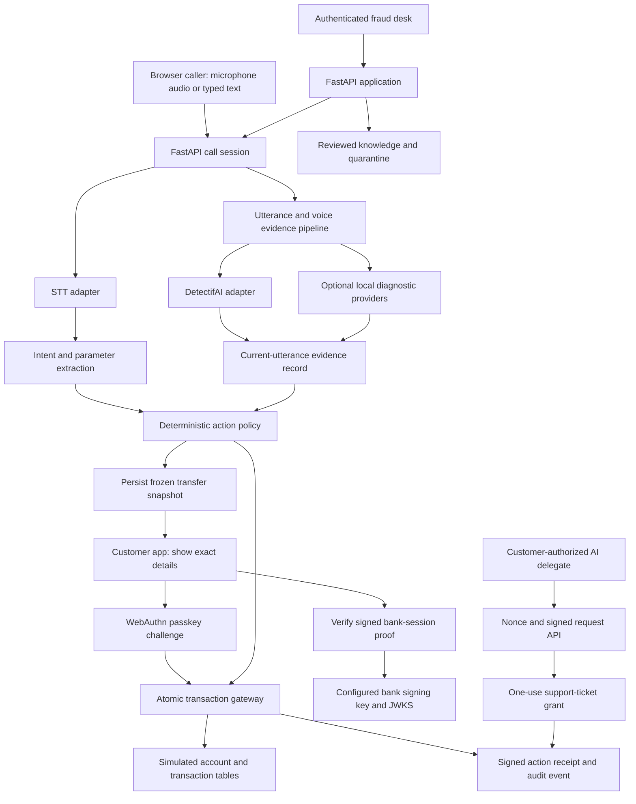

# Nishabdha architecture

Nishabdha is a browser-based voice banking prototype for the DetectifAI **Track 3: Unclone Agents** challenge. It demonstrates two linked trust questions:

1. **Who is making this request?** Voice authenticity is evaluated via DetectifAI deepfake detection on the current audio utterance without requiring pre-enrolled voice registration. Deepfake detection verifies that the voice is authentic human speech, but does NOT prove caller identity.
2. **How is caller identity established?** Caller identity is verified independently through authenticated companion application sessions, randomized liveness challenges, and out-of-band WebAuthn passkey step-up authorization for sensitive actions. Speaker verification is strictly optional and only evaluated when an authorized reference voice is already available through an authoritative source.
3. **What agent is acting, and what may it do?** The customer app can verify a signed bank-session record. A separate customer-authorized AI delegate can perform one narrowly scoped support operation via verifiable cryptographic credentials (ES256 JWK proofs).
4. **Natural Voice Human Scammer Defense:** Callers using natural human voices (0% deepfake score) are evaluated via conversation and intent risk analysis (urgency, coercion, impersonation, OTP requests) and deterministic action sensitivity gates.

The central design rule is that speech recognition and language models may help interpret a request, but they do not authorize or execute banking actions. A deterministic policy and execution gateway makes that decision. Sensitive transfers require both current voice evidence and a passkey approval of the exact frozen transaction.

This is a **simulated banking demo**, not a production banking platform. Voice evidence is a risk signal, application signatures prove claims made by a configured key, and a passkey assertion proves a WebAuthn ceremony occurred for this relying party. None alone establishes legal identity or guarantees that a user understood a screen.

## System at a glance

## Runtime and modules

The application is a single Python/FastAPI process. SQLAlchemy provides async database access; SQLite is the demo database. WebSockets carry browser voice sessions, customer-app notifications, and fraud-desk events. A React/Vite frontend provides navigation, accessible dialogs, and a CopilotKit policy assistant; the existing workspace controller retains the audio and banking browser flows. FastAPI serves the compiled UI, so deployment needs no additional Node process. Provider adapters isolate speech recognition, language model, text-to-speech, and voice-verification integrations.

| Area | Main implementation | Responsibility |
|---|---|---|
| HTTP and WebSocket application | `app/main.py`, `app/api/` | Startup, routers, authentication dependencies, live call and dashboard interfaces |
| Call orchestration | `app/core/session.py` | Call lifecycle, transcript turns, action policy, challenges, step-up, and live events |
| Voice evidence policy | `app/core/trust.py`, `app/core/liveness.py`, `app/providers/voice_engine.py`, `app/providers/detectifai.py` | Provider calls, evidence provenance/freshness, risk display, and fail-closed action gates |
| Action and banking rules | `app/core/policy.py`, `app/core/banking.py` | Intent risk tiers and simulated banking operations |
| Transfer authorization | `app/core/transactions.py`, `app/core/security_models.py` | Frozen transaction snapshots, action hashes, passkey-bound approval, and atomic execution |
| WebAuthn | `app/core/passkeys.py`, `app/api/passkeys.py` | Staff-assisted credential registration and customer authentication assertions |
| Agent identity and delegation | `app/core/agent_identity.py`, `app/core/agent_models.py`, `app/api/agents.py` | Bank signing key/JWKS, signed bank-session claims, and bounded AI delegate grants |
| Evidence and audit | `app/core/evidence.py`, `app/core/audit.py` | Fraud-desk reports, hash-chained audit events, and signed receipts |
| Knowledge | `app/knowledge/`, `app/api/knowledge.py` | Reviewed demo policies, extractive answers, staff research, and quarantined sources |
| Browser interface | `frontend/src/`, `app/static/workspace.js`, `app/static/security.js` | React shell, caller UI, customer approval, bank-proof verification, delegate demo, and fraud desk |
| Policy assistant | `frontend/src/PolicyAssistant.tsx`, `app/api/copilot.py` | Headless CopilotKit/AG-UI SSE integration with reviewed extractive policy answers and no banking tools |

The demo expects one application worker because active voice sessions are held in process memory. SQLite should live on persistent storage. The bank signing key is stored under `DATA_DIR` next to application data; persist and back it up with the database so signatures remain verifiable after restart.

## Trust boundaries

The design distinguishes four kinds of evidence and authority:

| Item | What it means | What it does not mean |
|---|---|---|
| Transcript or extracted intent | The application interpreted an utterance as a possible request | The caller is authentic, the interpretation is correct, or the request is authorized |
| Voice-provider result | A provider returned speaker/authenticity evidence for a particular audio sample | Legal identity, perfect deepfake detection, or authorization for a future utterance |
| WebAuthn assertion | A registered credential signed a fresh challenge for this RP and origin, with required user verification | A trusted hardware display of the transaction or proof the user understood it |
| ES256 agent proof | A holder of a configured private key signed claims that the verifier checked | Truth of claims from an unknown key, safety of the agent, or acoustic origin of phone audio |

Caller audio and transcripts, LLM output, retrieved documents, client playback events, browser-supplied identifiers, and delegate request bodies are untrusted inputs. The server creates action IDs, nonces, evidence timestamps, expiry values, approval bindings, and final execution records. The customer app trusts the bank origin and key configured for the app; it must not trust a key or link offered by the caller.

## Voice request and evidence flow

1. A caller starts a call through the app and connects using its call-scoped token. The browser streams PCM audio over a WebSocket, or submits a typed turn. The call session is associated with a known customer only through application records and the session flow; spoken names alone are not authentication.
2. The voice pipeline segments incoming audio and runs the configured STT and voice-verification adapters. The provider chain is configurable. Its actual request and result formats depend on the DetectifAI contract supplied to the team.
3. The server binds the check to the call, current action/utterance, captured audio hash, source provider, result status, and server timestamps. A previous result cannot satisfy a timed-out check for a later request. Missing, pending, degraded, flagged, and successful states remain distinct.
4. The intent extractor proposes an operation and parameters. The policy layer validates the operation, applies its risk tier, and requests clarification or customer step-up as needed. The model does not call the banking mutation directly.
5. Transfers require fresh, successful DetectifAI authenticity (deepfake detection) evidence for the requesting utterance. When an authorized reference voice exists, speaker verification is also evaluated. If required verification fails or is missing, the transfer is held or escalated. Sensitive transfers always require transaction-bound WebAuthn passkey approval on the customer companion app.
6. Liveness prompts and spoken random digits are supplementary replay friction. Client playback events are telemetry only; they cannot rewrite server timestamps. Latency is not treated as dependable proof against real-time cloning or relays.

The combined trust score is retained for investigative display. Explicit evidence predicates determine protected actions. This avoids presenting a normalized score as a calibrated probability or allowing unrelated historical evidence to offset a missing current check. Mock voice providers are permitted only in explicit test/demo configuration and must be visibly disclosed. An empty provider chain is unavailable, not a silent mock pass.

## Transfer approval and execution

### Freeze the action

Before presenting a passkey prompt, the server resolves the saved beneficiary exactly. A name must match one unique beneficiary; ambiguous names require selection. Fuzzy matching may suggest choices but is not used when executing a transfer.

The server stores a snapshot containing the customer and call IDs, source account, resolved beneficiary ID and destination details, amount in integer paise, currency, action ID/version, nonce, and expiry. It hashes the canonical snapshot. The customer app reads this persisted snapshot and displays the same details; it does not reconstruct them from the live conversation.

If amount, account, recipient, or operation changes, the pending approval is invalidated. The user must approve a newly frozen action. Legacy pending actions are cancelled during the additive security migration; historical executed transactions remain.

### Bind WebAuthn to the snapshot

Staff authorization is required to enroll a customer passkey. Knowing a published demo app token is not enough to register one. For a transfer, the server creates a fresh, expiring WebAuthn challenge associated with the customer, passkey credential, transfer action, and action hash. Verification checks challenge, origin, RP ID, credential ownership, signature, user-verification flag, expiry, and one-use state.

The app-token-only approval endpoint cannot approve a transfer. A valid WebAuthn assertion is required for each transfer, even when voice evidence is strong. The UI presents the transaction details before invoking the browser authenticator.

### Execute once

`execute_transfer` is the protected mutation boundary. In a `BEGIN IMMEDIATE` SQLite transaction, it reloads persisted state and checks the action hash and expiry, current call/customer restrictions, beneficiary eligibility, evidence freshness, verified unconsumed passkey approval, matching step-up, per-call policy, and sufficient balance. It conditionally debits the account and stores the transaction, action result, approval consumption, and signed receipt in the same database transaction.

The action ID is the idempotency key. A retry of an already executed action returns the stored result. Competing transfers cannot both spend the same balance. Conditional updates ensure only one concurrent approve/deny resolution wins. The current banking implementation is simulated and does not connect to a real payment rail.

## Bank agent identity

The application creates or loads a persistent P-256 signing key from `DATA_DIR/bank-signing-key.pem`. It signs ES256 JWT records and publishes the corresponding public key through `/.well-known/jwks.json`. A customer using the configured bank app can request a proof for an owned, active, confirmed outbound bank-call notice.

The proof includes issuer and audience, customer, agent identity, AI disclosure, call and notice IDs, reason, issue/expiry times, unique ID, and nonce. The UI verifies signature algorithm and key ID against the configured same-origin JWKS, then checks issuer, audience, call/notice binding, AI type, and validity period. The short spoken code is only a session matching aid.

This proves that the configured bank application signed a record for an authorized outbound session. It does not prove that arbitrary inbound telephone audio was generated by that bank agent. Inbound callers cannot create outbound bank-call notices.

## Bounded AI delegate

The delegate example demonstrates an AI agent proving key possession and staying within a customer grant. It is separate from the voice caller's identity and does not inherit the caller's permission.

1. The delegate creates a P-256 key pair. The customer app receives its public JWK and computes a canonical binding for the holder key, fixed scope `support_ticket.create`, maximum use of one, and ten-minute lifetime.
2. The customer authenticates with a passkey over that binding. Only then does the server issue a persisted grant for the named customer and holder key.
3. The delegate requests a fresh server nonce for the grant and signs a short-lived ES256 request proof. The proof binds grant, nonce, audience, issue/expiry time, request body hash, and unique request ID.
4. The server checks signature and key, nonce freshness, audience, exact operation, body hash, grant expiry/revocation, and remaining use. It atomically consumes the nonce and one-use grant while creating the support ticket.
5. The customer can revoke the grant. A second use, replay, expired signature, altered body, or transfer request is rejected.

The grant does not permit transfer, balance reads, or account changes. The delegate's self-description (“I am an AI”) grants no authority. The demo client is in `scripts/delegate_demo.py`; the browser interface also demonstrates a valid ticket, a denied transfer attempt, receipt verification, and replay refusal.

## Knowledge and research flow

Knowledge retrieval supports explanations and FAQs; it is not an authorization source. The current index uses hashed lexical features rather than a learned semantic embedding. The demo answers use reviewed, extractive source text and abstain when suitable evidence is unavailable. The spoken response is derived from the same accepted content.

The read-only CopilotKit sidebar uses the same lookup through an AG-UI event stream at `POST /api/copilot/policy`. It does not receive staff keys, customer tokens, account state, or live-call transcripts, and it ignores client tool definitions and system instructions. Details of the frontend transition and build are in [`FRONTEND.md`](FRONTEND.md).

Live caller turns do not launch web research. Staff-only research and scraping require an approved HTTPS host, reject private-address destinations, disable redirects, and stage fetched content in quarantine with a content hash. Staff inspect the exact content and approve the matching hash before it enters the reviewed retrieval set. A source URL alone is not treated as proof that its content is authoritative.

## Storage, migrations, audit, and receipts

SQLAlchemy models in `app/models.py`, `app/core/security_models.py`, and `app/core/agent_models.py` store banking demo data, calls/actions/approvals, passkey credentials, frozen transfers, delegation grants/nonces/tickets, and migration state. SQLite WAL supports concurrent dashboard reads; `BEGIN IMMEDIATE` serializes protected mutations. The application migration is additive. Version 2 creates security tables and invalidates outstanding legacy approvals/actions without deleting customer records or executed history.

Audit events are linked using an HMAC hash chain. Transfer and delegate outcomes can also carry ES256-signed receipts that a verifier can check against the published bank key. These controls can reveal changed records when the chain/checkpoint remains available. A hash chain alone cannot detect deletion of its final tail if no separate checkpoint was retained. Signatures establish that the configured key signed a receipt; they do not prove that the underlying action was wise or externally settled.

## Main interfaces

Authentication headers and routes are described in [`API.md`](API.md). The main security flows are:

| Flow | Endpoints |
|---|---|
| Staff-assisted passkey registration | `POST /api/admin/customers/{customer_id}/passkeys/options`, then `POST /api/app/passkeys/verify` |
| Customer pending-action review | `GET /api/app/pending` |
| Transfer passkey approval | `POST /api/app/passkeys/options` with `purpose: transfer`, then `POST /api/app/passkeys/verify` |
| Bank-session proof | `GET /.well-known/jwks.json`, `GET /api/app/bank-call/{notice_id}/proof` |
| Delegate grant | `POST /api/app/agents/delegation-binding`, passkey options/verification, then `POST /api/app/agents/grants` |
| Delegate execution | `POST /api/agents/grants/{grant_id}/nonce`, then `POST /api/agents/grants/{grant_id}/execute` |
| Delegate revocation | `POST /api/app/agents/grants/{grant_id}/revoke` |
| Quarantined-source review | Staff-only routes under `/api/knowledge/quarantine/` |

## Failure behavior

| Condition | Expected behavior |
|---|---|
| Required DetectifAI result missing, stale, timed out, or degraded | Hold voice transfer; expose evidence status and reason to staff |
| Explicit synthetic or speaker mismatch result | Lock relevant voice action and create review signal |
| Typed protected request | Require customer app step-up; typed input cannot inherit prior voice evidence |
| No passkey enrolled or invalid assertion | Do not execute transfer; show that staff-assisted setup or a fresh assertion is needed |
| Changed or expired transaction snapshot | Reject approval/execution and require a new action |
| Duplicate execution request | Return the already persisted outcome without a second debit |
| Duplicate/ambiguous saved beneficiary name | Ask customer to choose one exact beneficiary; do not guess |
| Revoked, expired, replayed, or overused delegate grant | Reject without creating a ticket |
| Delegate asks for operation outside its grant | Reject; transfer tools are not part of delegate scope |
| Research source is unapproved or its content hash changed | Keep it quarantined and unavailable to live answers |

## Deployment and key configuration

For a stable demo, run a single Uvicorn worker, configure unique staff and audit secrets, persist `DATA_DIR`, and set a fixed `BANK_ORIGIN` plus matching `WEBAUTHN_RP_ID`. Hosted use requires HTTPS and the exact origin/RP configuration. Keep the bank signing key with the database backup. Do not rely on ephemeral disk or multiple workers with in-memory call state.

The exact DetectifAI endpoints, payloads, thresholds, score directions, audio requirements, and operational characteristics must come from the participant API contract. Do not invent those values or present test mocks as live detection results. No production accuracy, latency, or regulatory claim follows from the prototype tests.

## Demo narrative

The demo should make the two sides of trust visible:

1. Start a browser call and show the fraud desk binding speaker/authenticity evidence to the live utterance.
2. Attempt a transfer without the required evidence or with a synthetic/speaker mismatch signal; show the hold and reason.
3. Run an authorized simulated transfer. Resolve the exact beneficiary, display the frozen transaction in the customer app, complete a passkey assertion, execute it once, and verify the receipt.
4. Show the configured bank app verifying a signed outbound agent-session record, explaining that this proves the app session rather than telephone audio.
5. Grant the AI delegate permission for one support ticket, create the ticket, then show transfer and replay attempts being refused.
6. Show a knowledge answer backed by reviewed text and a quarantined research item awaiting staff approval.

Use visibly labeled demo fixtures when live vendor credentials or physical authenticators are unavailable. The actual validation results and outstanding live checks are recorded in [`VALIDATION.md`](VALIDATION.md); the security-specific limits are in [`SECURITY.md`](SECURITY.md).
